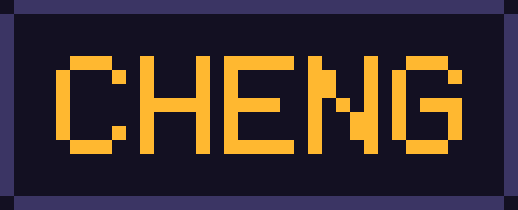

**LV.01 · SOFTWARE ENGINEER · C# / Unity**

街機風格的個人網站，放我的技術背景與作品。
從 Unity 客戶端、.NET 伺服器到實體硬體整合，每個作品都寫了當時的技術選擇與取捨。

---

## ▶ PRESS START

### 🕹 [https://chenghsichenggit.github.io/Portfolio-Website/](https://chenghsichenggit.github.io/Portfolio-Website/)

---

## ▶ FEATURES

| | |
|---|---|
| 🌐 **四語介面** | 繁體中文 / 简体中文 / English / 日本語，依瀏覽器語言自動選擇 |
| 🌙 **日夜模式** | 深色＝街機暗色調，淺色＝掌機淡色調 |
| 🎮 **作品分類** | 精選 / 專案 / 工具，點開看完整介紹 |
| 📜 **技術細節** | 每個作品都有使用工具、負責內容、技術亮點與已知限制 |
| 🎞 **多種封面** | 圖片、GIF、影片檔與 YouTube 預覽 |

---

## ▶ BUILT WITH

純 HTML / CSS / JavaScript — 沒有框架，沒有建置流程，由 GitHub Pages 直接部署。

設計上只守一條規則，讓人一眼分辨哪些能點：

```
可點擊 ─ 方形、3px 外框、硬陰影；滑過整體上浮，按下整體下壓
資訊類 ─ 不用方塊，也沒有單一元件的 hover 動態
```

---

## ▶ CREDITS

字型：[俐方體11號 Cubic 11](https://github.com/ACh-K/Cubic-11)（SIL OFL 1.1）

```
            © 2026 CHENG
    PRESS START TO CONTINUE
```
